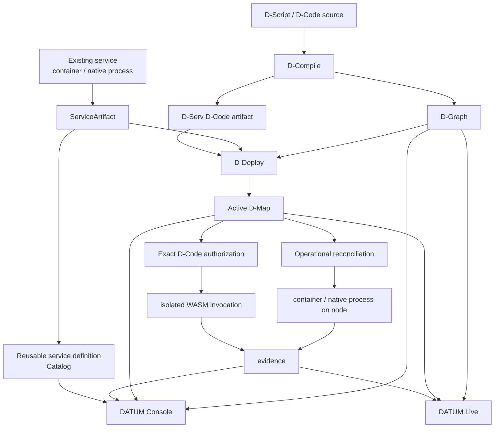

# DATUM

**Describe software. Govern where it runs. See what is happening. Execute exact content. Observe what really happened.**

DATUM is an architectural framework and information model for distributed applications across the **IoTinuum**: heterogeneous resources spanning devices, edge, fog and cloud environments.

!!! info "DATUM v1"
    This edition documents the current DATUM v1 implementation and is grounded in source revision `3605845b7933195e470c9a13473fbc05432c4a26`. See [status and limitations](overview/status.md).

## From software model to governed execution and graphical operations

Compilation is not deployment. Registration is not activation. Accepted placement is not runtime realization. Installed content is not execution authority. Evidence is not placement. The Console visualizes these domains without becoming a second source of truth.

- **Use the DATUM Console**

    Start the graphical interface, browse projects, inspect accepted logical graphs and runtime evidence, and work with the reusable service catalog.

    [DATUM Console tutorial](tutorials/datum-console.md)

- **Keep DATUM Live on a secondary screen**

    Build persistent local Live views, pin D-Nodes from the global Continuum, inspect host observations and active attention, and use responsive kiosk mode without creating a frontend health authority.

    [DATUM Live tutorial](tutorials/datum-live.md)

- **Understand the service catalog**

    Learn the difference between reusable service definitions, operational `ServiceArtifact` records and canonical D-Code artifacts.

    [Service catalog](concepts/service-catalog.md)

- **Model an existing service**

    Turn real software facts into a DATUM operational model.

    [Model an existing service](tutorials/model-existing-service.md)

- **Deploy Mosquitto end to end**

    Follow a real artifact through registration, D-Graph, placement acceptance, reconciliation authorization and node execution.

    [Mosquitto end-to-end tutorial](tutorials/mosquitto-end-to-end.md)

- **Understand WebAssembly and D-Code**

    Learn modules, imports/exports, the `datum-dnode/0` ABI, sandboxing and runtime limits.

    [WebAssembly and D-Code](concepts/webassembly-and-dcode.md)

- **Read the technical reference**

    Inspect contracts, Console/catalog APIs, readiness semantics and immutable source provenance.

    [Technical reference](reference/index.md)

## What the graphical surfaces add

The Console provides the full management workspace over server-owned authority, read projections and catalog data. The current interface includes:

- global overview and project navigation;
- global and project Continuum views;
- project workspace and application operational context;
- logical D-Graph inspection and a draft editor;
- placement candidate generation, validation and proposal creation;
- proposal review and explicit acceptance of placement authority;
- deploy/reconciliation request workflows whose host mutation is still performed by the node agent under separate authorization;
- read-only DMonitor history;
- the reusable Artifact & Service Catalog.

DATUM Live is a separate read-only, continuously refreshed surface. It can pin D-Nodes from the global Continuum, show host resource observations, placement-scoped DMonitor evidence, active attention and recent activity, and run in a responsive kiosk/fullscreen layout. It does not deploy, accept proposals, edit D-Graphs or derive health from CPU/memory thresholds.

## The core rule

DATUM keeps different questions in different authority/evidence domains:

| Question | Primary representation |
|---|---|
| What functionality did the author describe? | D-Script / D-Functions |
| What logical application exists? | D-Graph / D-Serv / D-Call |
| How can an existing long-running service be realized? | project-scoped `ServiceArtifact` |
| What reusable service definition do operators want to catalog? | versioned service catalog definition |
| What exact application-code content describes a D-Serv revision? | `datum.dserv-artifact/1` + WASM content digest |
| Where and which exact revision is currently authorized? | accepted D-Map/D-Deploy authority and exact bindings |
| May this node mutate the host now? | finite operational reconciliation authorization + local policy |
| What actually happened at runtime? | runtime reports/evidence and DMonitor observations |
| What can an operator manage graphically? | Console workspaces backed by the owning control/read domains |
| What should remain continuously visible? | DATUM Live read-only projections over global operations and Continuum evidence |
| Is the required realization usable now? | readiness derived from admitted current evidence |

Source links are immutable and [provenance is explicit](reference/sources.md).
